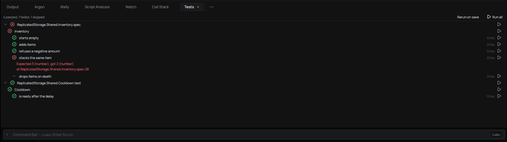

# Testing a place's Luau

rbx-native runs a place's unit tests headlessly, in the same Luau sandbox
as the Command Bar and `rbxlua`: no Studio, no Roblox client, no account.
The runner lives in `rbx_lua::test_runner`; the editor's **Tests** dock and
`rbxlua test` are two views of it.

## Writing specs

A spec is a `ModuleScript` whose name ends in `.spec` or `.test`, anywhere
in the place (TestEZ's convention). Specs under a folder named `_Index`
are skipped: that is where Wally vendors packages, specs included.

```lua
-- ReplicatedStorage.Shared.Inventory.spec
local Inventory = require(script.Parent.Inventory)

return function()
	describe("Inventory", function()
		local inventory
		beforeEach(function()
			inventory = Inventory.new()
		end)

		it("starts empty", function()
			expect(inventory:count()).to.equal(0)
		end)

		it("refuses a negative amount", function()
			expect(function()
				inventory:add("Sword", -1)
			end).to.throw("negative")
		end)
	end)
end
```

**TestEZ API:** `describe`, `it`, `beforeAll`, `afterAll`, `beforeEach`,
`afterEach`, `SKIP()`, `FOCUS()`, `itSKIP`/`itFOCUS`,
`describeSKIP`/`describeFOCUS`, `xit`/`fit`/`xdescribe`/`fdescribe`; and
`expect(x)` with the chain words `to`, `be`, `been`, `have`, `was`, `at`,
`.never`, and the matchers `equal`, `ok` (not `nil`), `a`/`an` (a `typeof`
name), `near(x, limit)` and `throw(fragment?)`.

**Jest-Lua names** work beside them: `test`, `describe.skip`/`.only`,
`it.skip`/`.only`, and `toBe`, `toEqual` (deep), `toBeTruthy`,
`toBeFalsy`, `toBeNil`, `toThrow`, `toContain`, `toHaveLength`,
`toBeCloseTo`, `toBeGreaterThan(OrEqual)`, `toBeLessThan(OrEqual)`, with
`.never` to negate. A spec may declare its tests at the top level instead of
returning a function. A Jest-Lua spec that `require`s `JestGlobals` from
its packages still needs those packages in the place; the runner does not
ship Jest-Lua itself. Matchers outside these lists fail the test with
"is not a matcher this runner knows".

`FOCUS` works across the whole run, as in TestEZ: once any test anywhere is
focused, only focused tests run, and the rest are reported skipped.

**Loren specs** (`return function(t)` with `t.describe`, `t.it(name, fn,
{ skip = true })`, `t.expect`, `t.spy` and the hooks) run through Loren's
own runner (`rbx_loren::specs`), with the stand-ins Loren's runtime needs
in the sandbox, so `WaitForChild` and a running server look the way Loren's
unit specs expect. They show up in the same tree and the same report. The
plain runner also takes them: it hands `t` the names above.

Script Analysis knows the TestEZ and Jest-Lua globals (`testez.d.luau`,
loaded into luau-lsp beside Roblox's API), so a spec file doesn't light up
with "Unknown global 'describe'".

## How a run behaves

- **Isolation.** Each spec file runs in a VM of its own over a fresh copy of
  the place, so nothing one file's tests change (instances, attributes,
  module state) is visible to another file. Tests within one file share
  their file's copy, as they share a Studio session.
- **Time is simulated.** `task.wait`, `wait`, `task.delay` and `time()`
  run on a clock that jumps straight to the next wake-up: `task.wait(30)`
  returns at once with 30 seconds passed. A file whose threads would still
  be waiting after ten simulated minutes fails the running test with
  "still waiting after 600 s of simulated time". `os.time()`,
  `DateTime.now()` and `os.clock()` stay on the real clock.
- **A test that can never finish fails instead of hanging.** Waiting on a
  signal no code fires (`Event:Wait()` on a `BindableEvent` nobody fires, a
  remote from a client that does not exist) fails that test with "never
  finished", and the rest of that file is not run.
- **A runaway loop** (`while true do end`) is stopped by the sandbox's
  10-second execution budget and fails the test that ran it.
- **Failures** carry the message, the script and line they were raised on
  (the first stack frame in one of the place's own scripts, so a failure in
  a helper module points at the helper) and the Luau stack.

## What the sandbox does not have

Tests run where no game is running, so code that reaches for the engine's
live systems errors rather than pretending. Measured against the sandbox:

| Commonly hit | What happens |
|---|---|
| `HttpService:GetAsync`/`PostAsync`/`RequestAsync` | Errors: "not available from the command bar: it has no network access". `JSONEncode`/`JSONDecode`/`GenerateGUID`/`UrlEncode` work. |
| `DataStoreService`, `MemoryStoreService`, `MessagingService` | The services exist; their methods error ("GetDataStore is not a valid member of DataStoreService"). Inject a fake store into the code under test. |
| `RunService.Heartbeat`/`Stepped`/`RenderStepped`, `RunService:IsServer()` | Not members: errors. There are no frames to step. |
| `Players:GetPlayers()`, `Players.LocalPlayer` | `GetPlayers` errors; `LocalPlayer` is `nil`. |
| `TweenService:Create`, `MarketplaceService`, `UserInputService` | Methods error. |
| `RemoteEvent:FireServer`/`FireClient` | Returns without doing anything: there is no other side. |
| Physics: `Touched`, `workspace:Raycast`, `Humanoid:MoveTo` | Not members: errors. |
| `task.*`, `BindableEvent`/`BindableFunction`, instance events (`Changed`, `GetPropertyChangedSignal`, `ChildAdded`, attributes), `CollectionService`, `require`, datatypes, `Random`, `Enum` | Work as in Roblox. |

The common pattern for code that touches these is the one TestEZ projects
already use: pass the service (or a table standing in for it) into the
module under test, and give it a fake in the spec.

## From the command line

```sh
rbxlua test place.rbxl                         # every spec; exit 1 on a failure
rbxlua test place.rbxl --filter "Inventory"    # names containing the text
rbxlua test place.rbxl --root ReplicatedStorage.Tests
rbxlua test place.rbxl --format json           # machine-readable report
rbxlua test place.rbxl --junit results.xml     # plus JUnit XML for CI
```

`--filter` matches a test's describe names and its own, space-joined.
`--root` (repeatable) limits discovery to those subtrees. The exit code is
0 when nothing failed (including when there was nothing to run), 1 when a
test failed or the place could not be read, 2 for a usage error.

`rbxlua test` reads a place file (`.rbxl`, `.rbxlx`) or a Rojo/Argon
project folder. A folder is read the way Rojo builds it from its
`default.project.json`: `$path`s, `$className`s, `init.luau` folder
modules, `.server`/`.client` scripts and nested projects. It skips
`.json`/`.txt`/`.rbxm` files, so a project that needs those should build a
place first (`rojo build -o place.rbxl` or `argon build`).

## In GitHub Actions

`.github/actions/rbxlua-test` builds `rbxlua` from this repository and runs
it. In a game's own repository:

```yaml
name: Tests
on: [push, pull_request]
jobs:
  luau:
    runs-on: ubuntu-latest
    steps:
      - uses: actions/checkout@v4
      - uses: chteau/rbx-native/.github/actions/rbxlua-test@dev
        with:
          place: .   # the project folder, or a place you built first
          junit: results.xml
      - uses: actions/upload-artifact@v4
        if: always()
        with:
          name: luau-test-results
          path: results.xml
```

The first run builds `rbxlua` from source (a few minutes); the Rust cache
makes later runs fast. Inputs: `place` (required), `filter`, `roots`
(space-separated), `junit` (default `rbxlua-test.xml`, empty for none) and
`branch` (the rbx-native branch to build, default `dev`).

## In the editor

The **Tests** dock (Script Editor; the ribbon's Tests toggle) lists every
spec file with its describes and tests, as declared, before anything runs.
Run all from its header, or one file, describe or test from its row's play
button; a failure shows its message under the test, and clicking it opens
the script at the line it was raised on. **Rerun on save** runs the whole
suite again after each Ctrl+S. Selecting a row fills the output pane under
the tree: a test's failure, its traceback and what it (and its hooks)
printed, warnings and errors in their colours; a file row shows everything
the file printed.


